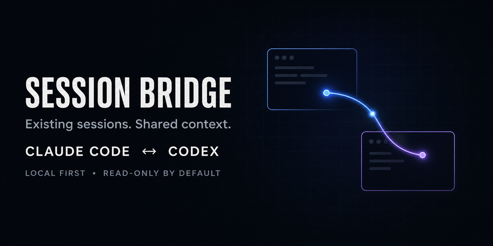

<div align="center">



# Session Bridge

**Governed context synchronization for agents that already exist.**

[](https://github.com/trigga6006/session-bridge/actions/workflows/security-tests.yml)


</div>

Session Bridge connects existing Claude Code and Codex sessions locally or across the public internet. Its Context Ledger turns useful session state into typed, provenance-linked, versioned claims; minimizes those claims for a named recipient; signs and encrypts the disclosure; then quarantines and reconciles it at the other end without silently choosing a winner.

It is built for the handoff that a ticket cannot capture: the research, decisions, constraints, rejected paths, tests, uncertainty, and open questions still living inside independent agent threads.

## The boundary

Session Bridge is not another generic agent protocol, tool bus, directory, or orchestrator.

| Layer | Session Bridge position |
|---|---|
| [A2A](https://a2aproject.github.io/A2A/latest/specification/) | A tested A2A-shaped data Artifact carries one complete signed disclosure and grant. Session Bridge does not implement or claim conformance with A2A discovery, tasks, messages, or transports. |
| [MCP](https://modelcontextprotocol.io/specification/) | A local stdio server exposes the full ledger quarantine/review/accept lifecycle as closed-schema tools/resources. MCP owns invocation and transport, not context semantics. |
| [AGNTCY / SLIM](https://docs.agntcy.org/) | No integration is shipped. Those projects address directory, identity, messaging, and observability; Session Bridge does not claim those capabilities. |
| Scoped coordination | The temporary encrypted bridge includes short-lived task-scoped notes for questions and acknowledgements. Notes are not ledger state and cannot bypass signed disclosure acceptance. |
| Context Ledger | Owns extraction, semantic revisions, recipient minimization, disclosure grants, provenance, freshness, conflicts, quarantine, and the who-was-issued-what audit. |

The durable unit is a context change, not a chat message:

```text
session -> extract -> review -> approve -> commit -> diff -> minimize -> sign -> encrypt
        -> quarantine -> verify -> reconcile -> supersede / expire / revoke
```

## Install

Ask either agent to install the skill for your user account:

```text
Install the Session Bridge skill from https://github.com/trigga6006/session-bridge for my user account.
```

Manual skill locations:

| Product | User skill path |
|---|---|
| Codex / ChatGPT | `~/.codex/skills/session-bridge` |
| Claude Code | `~/.claude/skills/session-bridge` |

For the packaged developer CLIs:

```bash
python -m pip install "git+https://github.com/trigga6006/session-bridge.git"
```

This installs `session-bridge`, `session-bridge-network`, `braid`, and `braid-mcp`. The skill can also run its checked-in scripts directly, so a global package install is optional.

## Fastest agent workflow

Host:

```text
Use Session Bridge as host. Catch my agent up with my teammate's agent about <scope>. Exchange relevant thread context, reconcile conflicts, and keep watching until both sides have the same final summary.
```

Join:

```text
Use Session Bridge as joiner with this code: <private code>. The scope is <scope>. Share relevant context from this thread and stay in the loop until both sides are synchronized.
```

Both humans compare one six-digit safety code through a trusted side channel. That approval opens a temporary, task-scoped collaboration; it does not authorize commands, deployments, file changes, purchases, or unrelated disclosure.

## Context Ledger

Each installation creates one persistent, key-derived recipient identity automatically. Extract candidates from an existing local session, inspect the exact stage, approve its digest, and then commit it:

```bash
braid --project phoenix extract --session "<session-id>" --provider codex --stage
braid --project phoenix review-staged <stage-id>
braid --project phoenix approve-staged <stage-id> --review-digest <sha256:digest>
braid --project phoenix commit --author "alice" --stage-id <stage-id>
```

`review-staged` is deliberately read-only; it displays the claims and returns a digest. `approve-staged` binds approval to that exact digest, and `commit` rechecks it. Concurrent agents receive separate stage IDs, so one agent cannot overwrite or commit another agent's staged context. To stage an already inspected claims file, use `stage --claims candidates.json`, then run the same review and approval steps. State defaults to `~/.session-bridge`; set `SESSION_BRIDGE_HOME` for an isolated workspace. Global `--home <path>` is for standalone ledger tests; a paired bridge and ledger must share the same `SESSION_BRIDGE_HOME` so they use the same recipient identity. Project ledgers persist until the user applies their own retention policy.

The extractor blocks credential-shaped events, redacts common PII, ignores prompt-injection-shaped instructions, suppresses low-signal acknowledgements, and stores source hashes/spans rather than raw transcript text as provenance.

Inspect the current state:

```bash
braid --project phoenix status
braid --project phoenix log
braid --project phoenix diff <before-revision> <after-revision>
braid --project phoenix freshness
braid --project phoenix verify
```

Preview a recipient-minimized plan without sending:

```bash
braid --project phoenix plan \
  --recipient "<peer-ed25519-principal-from-status>" \
  --purpose "API migration handoff" \
  --max-sensitivity internal
```

Create an exact recipient-bound signed disclosure:

```bash
braid --project phoenix export <revision> \
  --recipient "<peer-ed25519-principal-from-status>" \
  --purpose "API migration handoff" \
  --output bob-context.json
```

At the receiver, the ledger automatically uses that installation's persistent recipient key. Verification still produces quarantine, not authority:

```bash
braid --project phoenix import bob-context.json
braid --project phoenix review-import <token>
braid --project phoenix accept <token>
braid --project phoenix reconcile --local <revision> --remote <revision>
```

`import` only verifies and quarantines; it returns `reviewed: false` and the exact `review-import` next step. Acceptance is unavailable until that separate command revalidates and displays the redacted review.

`status` reports the local `ed25519:<key-id>` principal. The optional global `--principal` flag is an expected-identity pin, not an alias: any value other than the endpoint's key-derived principal is rejected. A disclosure for one endpoint cannot be promoted by a different endpoint even if it obtains the signed file.

Divergent active claims with the same semantic key remain a durable unresolved conflict. With two heads, `reconcile` returns a one-use `reconciliation_token` and the exact conflict set. Pass that token to `resolve --claims <file> --message <reason> --reconciliation-token <token>`, then review, approve, and commit the resulting stage. Every conflict must be retained as a `disagreement` claim or explicitly superseded with provenance; a normal commit cannot collapse two heads.

## Public internet bridge

Local discovery/export downloads nothing. Public joining needs pinned `cryptography` if it is not already available. Public hosting additionally uses a pinned, checksum-verified Cloudflare Tunnel helper; a managed HTTPS tunnel can be supplied instead. There is no Session Bridge account, DNS change, router configuration, or API key.

Prepare only the role you need:

```bash
python scripts/network_bridge.py setup --role host
python scripts/network_bridge.py setup --role host --yes
```

Each side proves possession of a persistent Ed25519 recipient key during pairing. The key-derived principal is bound to the room, ephemeral exchange key, peer, and expiry; arbitrary self-asserted labels are not accepted. After safety-code approval, `status` shows both principals. Export to the displayed remote principal, then send the signed bundle with `share`:

```bash
python scripts/network_bridge.py share --id <room-or-connection-id> --bundle-file bob-context.json
python scripts/network_bridge.py watch --id <room-or-connection-id> --wait 45 --json
```

The relay rejects a disclosure addressed to anyone other than the approved channel peer. Signed context events are authenticated before relay, application-encrypted in transit, and remain untrusted until imported into the matching receiver-principal ledger's quarantine. A saved JSON `watch` response containing exactly one context-pack event can be passed directly to `braid import`.

## Interoperability

`scripts/context_adapters.py` maps a complete `context-disclosure/v1` bundle to one strict A2A-shaped data Artifact with MIME type `application/vnd.braid.context-disclosure+json;version=1`. Its test crosses the artifact boundary into receiver quarantine and acceptance. It deliberately creates no task lifecycle and is not a claim of full A2A conformance.

`braid-mcp --project <name>` exposes the same ledger as a line-delimited MCP stdio server. It enforces MCP initialize/initialized lifecycle and JSON-RPC ID rules. Its closed-schema tools include stage/review/approval/commit, live conflict and freshness resources, and import quarantine/review/accept; the adapter adds no second database or context representation. An optional `--principal <ed25519:id>` pins the expected local endpoint identity.

## Security properties

- X25519, HKDF-SHA-256, and ChaCha20-Poly1305 for temporary network channels.
- Ed25519 persistent author identities protected by Windows DPAPI, macOS Keychain, Linux Secret Service, or a restricted local fallback.
- Signed exports and non-delegable grants bound to exact recipient, project, scope, policy digest/version, parent digest, and expiry; both relay and receiver enforce the configured recipient.
- Strict JSON shape/depth/size limits, duplicate-key rejection, credential scanning, PII redaction, request limits, and replay counters.
- Crash-safe request retransmission prevents an accepted request with a lost response from desynchronizing the channel or duplicating a side effect.
- Append-only hash-chained audit, exact claim disclosure records, freshness states, revocation tombstones, and quarantine-first imports.
- State transitions write a hash-chained intent before multi-file mutation; an incomplete transition makes audit verification fail closed instead of disappearing from forensic history.
- The bundled tunnel helper is release- and SHA-256-pinned. Arbitrary `cloudflared` binaries found on `PATH` are not executed implicitly.

Read [SECURITY.md](SECURITY.md) and [the network security model](references/network-mode.md) before using sensitive material.

## Verification and benchmarks

```bash
python -m pip install --requirement requirements.txt
ruff check scripts tests benchmarks
ruff format --check scripts tests benchmarks
python -m compileall -q scripts benchmarks tests
python -m unittest discover -s tests -v
python -m benchmarks.product_benchmark --out benchmark-results
python -m benchmarks.lifecycle_benchmark --iterations 3 --out benchmark-results/lifecycle.json
python -m benchmarks.context_quality.runner --engine reference --holdout-seed 20260722 --out benchmark-results/context-contract
python -m pip install --no-deps .
braid --help
```

The product benchmark invokes the real extractor, semantic model, recipient planner, signing, quarantine, import, and conflict logic. It records required-context recall, low-signal suppression, compression, latency, peak Python allocation during extraction, conflict preservation, and signed round-trip gates. The lifecycle benchmark separately measures 10/100/500-claim stage-review-approve-commit-export-quarantine-review-accept latency, peak Python allocation, and signed bundle size. Adapter, receiver-replay, MCP lifecycle, review-gate, ancestry, rollback, head-bound, and encrypted retransmission behavior are covered by the test suite rather than the product benchmark. The separate context-quality harness is a protocol contract and adversarial evaluator; its `reference` engine is an oracle, not a product score.

See the checked-in [0.3.0 benchmark baseline](benchmarks/BASELINE.md) for reproducible commands, environment, results, and measurement limits.

CI runs lint and format checks, compilation, the full suite, the real-product benchmark, and package installation on Windows, macOS, and Ubuntu with Python 3.11 and 3.13. Separate Ubuntu jobs audit the pinned runtime dependency and build/check the wheel and self-testing source distribution.

## Release status and honest limits

Version `0.3.x` is an open-source developer preview suitable for controlled team pilots, not a claim of SOC 2 readiness, guaranteed availability, or bug-free production use.

- Quick Tunnels provide convenience, not an enterprise SLA.
- Endpoint compromise defeats confidentiality for context that endpoint may read.
- Revocation cannot erase a copy already delivered; it prevents future local use/re-sharing and records intent.
- Pairing principals are cryptographic endpoint pseudonyms with proof of key possession, not verified human or organization identities. Context authors are pinned on explicit first acceptance. Enterprise SSO/directory mapping, centralized lifecycle policy, transparency logging, retention enforcement, and compliance exports remain future control-plane work.
- Agents cannot wake after their application ends a turn. The skill keeps the active turn watching while both agents are running.
- Automatic extraction is deterministic and conservative, not an infallible semantic model. Review remains mandatory before commit/disclosure.

Apache-2.0 licensed. Contributions and security reports are welcome.
